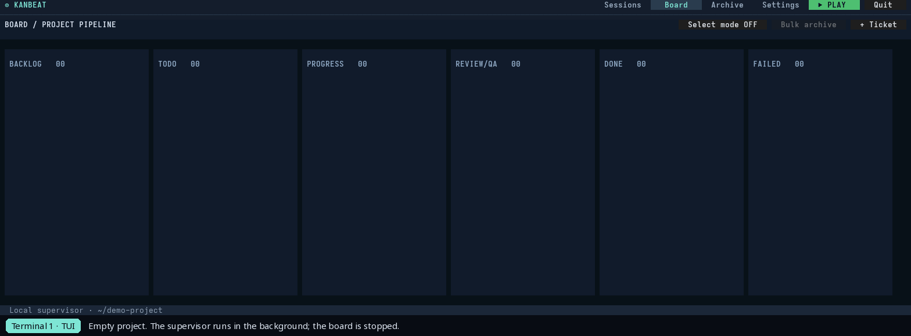
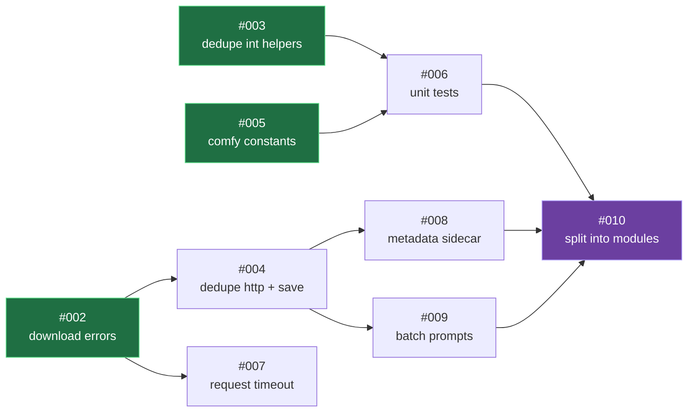
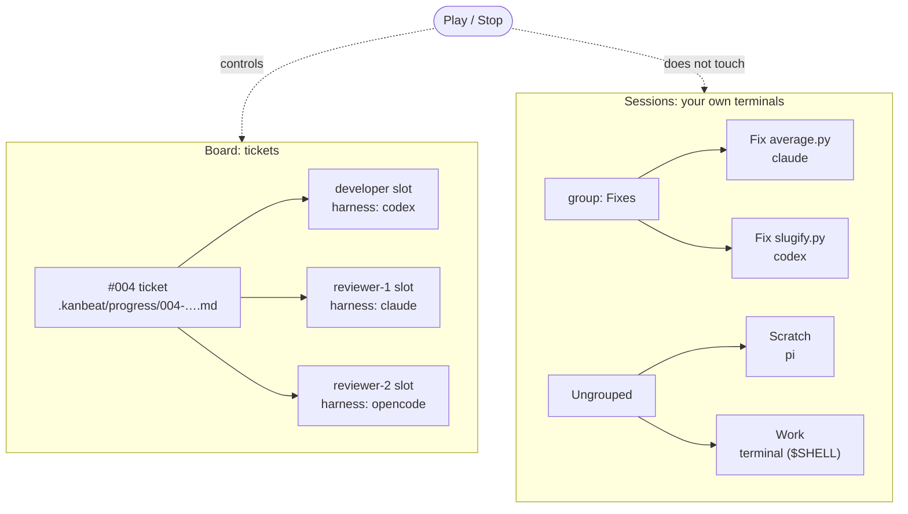
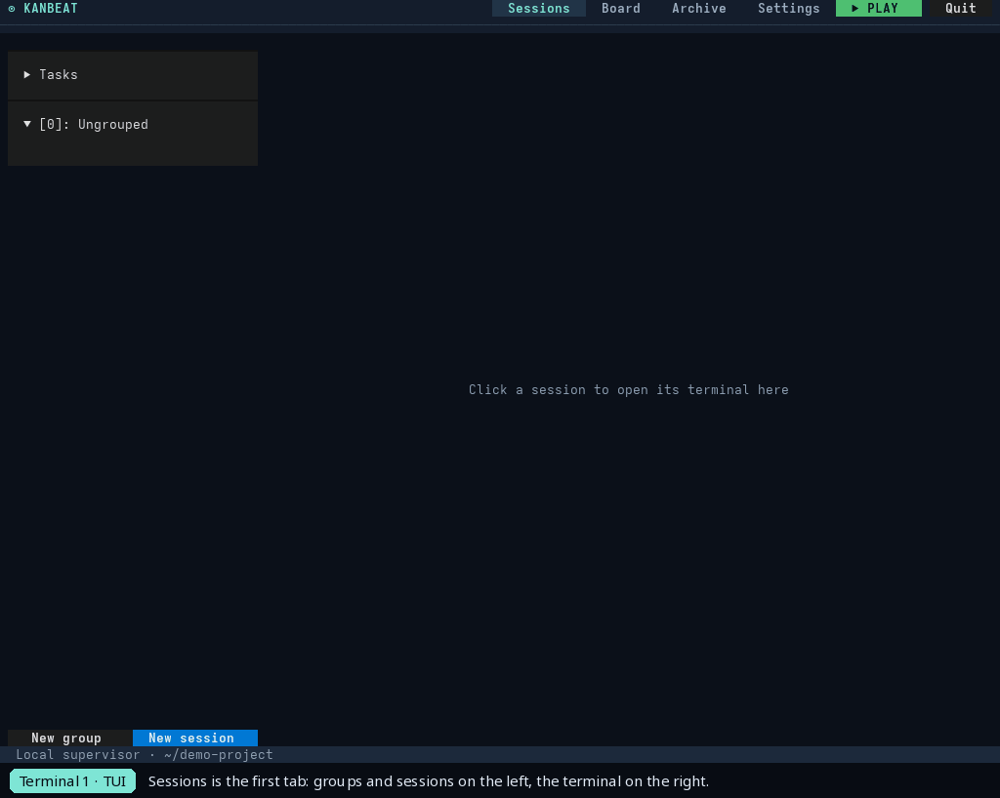
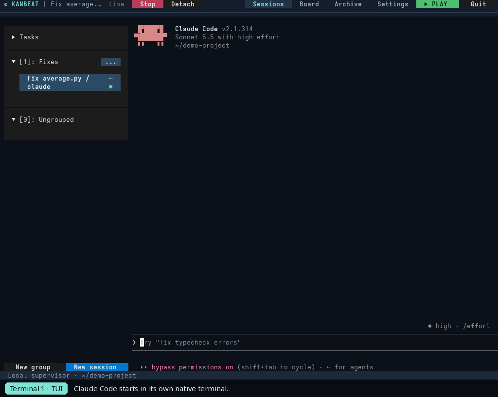
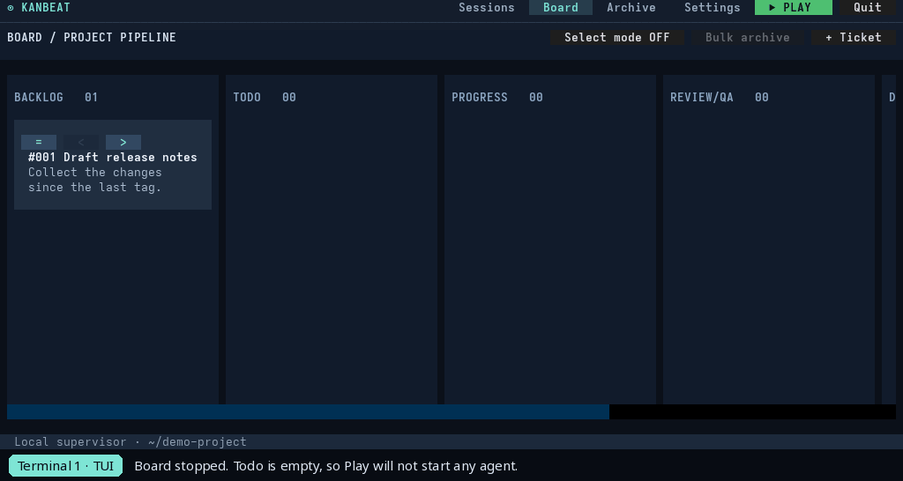

<div align="center">

# Kanbeat

**A filesystem-native Kanban board and local supervisor for AI coding agents.**

A ticket is a Markdown file, its status is the directory it lives in, and one persistent supervisor per project runs your own coding CLIs against the queue.

[](https://github.com/arconw/Kanbeat/actions/workflows/ci.yml)
[](https://github.com/arconw/Kanbeat/releases)


[Install](#installation) ·
[Quick start](#quick-start) ·
[Tickets and dependencies](#tickets-and-dependencies) ·
[Sessions](#sessions) ·
[Limitations](#limitations) ·
[Docs](#documentation)

</div>

> **Early release, not production-ready.** The board, supervisor, structured worker flow, transition hooks, persistent terminals and session groups are implemented and covered by automated tests. Codex, Claude and OpenCode protocol paths were exercised against deterministic local fake APIs, but not against real remote models or every vendor CLI version, and agents edit your working tree. Read [Limitations](#limitations) first.



*Recorded from the real TUI against a real supervisor. The tickets are moved by hand; no agent ran. See [how the demos are made](docs/media.md).*

## Why Kanbeat

- **Files are the board.** Tickets live in `.kanbeat/<column>/<id>-<slug>.md`. Moving a file moves the ticket, and you can edit tickets in any editor or script them from the shell. No frontmatter, no hidden metadata, and everything can be committed with your project.
- **One supervisor per project.** `kanbeat` starts or joins it. Closing a TUI never stops work, and several terminals can watch the same board.
- **Bring your own CLI.** Codex CLI, Claude Code, OpenCode and Pi run through their native modes with your own login, permissions and sandbox. Kanbeat embeds no agent and never overrides those settings.
- **Dependencies and parallel work.** A ticket can say `Blocked by: #002`. Independent tickets run in parallel, blocked ones wait in Todo, and a whole batch drops into Todo and works through itself in order.
- **Developer, then Review/QA.** A developer turn moves a ticket to Review/QA, where zero or more reviewer slots with isolated contexts approve it or send it back with feedback.
- **Native terminals and sessions.** Attach to a running harness live, or keep independent sessions in groups. Every session has a native id, so it resumes where it stopped.
- **Transition hooks.** Optionally run a prompt in a fresh native session after each column change Kanbeat makes.

## Installation

Kanbeat needs **Python 3.11 or newer** and **Git**, and at least one native CLI on your `PATH` that is already logged in: `codex`, `claude`, `opencode` or `pi`. Kanbeat does not log in for you.

| System | Status |
| --- | --- |
| Linux | Supported, tested in CI on Python 3.11, 3.12, 3.13 and 3.14 (x86_64 and arm64 archives). |
| macOS | Supported, tested in CI on Python 3.14 (Apple silicon and Intel archives). |
| Windows (WSL) | A Linux runtime; install inside WSL as on Linux. Not yet tested on a Windows host. |
| Windows (native) | Not supported: the supervisor uses POSIX APIs. A port is tracked in [#11](https://github.com/arconw/Kanbeat/issues/11). |

Kanbeat is not on PyPI or Homebrew. Pick one of the options below; the tag in the commands is the release to install.

### Linux and macOS: uv (recommended)

```sh
# once: install uv (https://docs.astral.sh/uv/) and make sure Git is present
curl -LsSf https://astral.sh/uv/install.sh | sh
uv tool install git+https://github.com/arconw/Kanbeat.git@v0.9.0
kanbeat --version
```

If `kanbeat` is not found afterwards, run `uv tool update-shell` and reopen the terminal. Update with `uv tool install --force git+https://github.com/arconw/Kanbeat.git@<new tag>`; remove with `uv tool uninstall kanbeat`.

### Linux and macOS: pipx

```sh
pipx install git+https://github.com/arconw/Kanbeat.git@v0.9.0
pipx ensurepath
```

### Linux and macOS: plain pip

```sh
python3 -m venv ~/.venvs/kanbeat
~/.venvs/kanbeat/bin/python -m pip install git+https://github.com/arconw/Kanbeat.git@v0.9.0
~/.venvs/kanbeat/bin/kanbeat --help
```

Run `~/.venvs/kanbeat/bin/kanbeat`, or add that `bin` directory to your `PATH`.

### Prerequisites by system

| System | Python, Git and a package tool |
| --- | --- |
| Debian / Ubuntu | `sudo apt install python3 python3-venv pipx git` |
| Fedora | `sudo dnf install python3 pipx git` |
| Arch | `sudo pacman -S python python-pipx git` |
| macOS (Homebrew) | `brew install python git uv` |
| Windows | Install [WSL](https://learn.microsoft.com/windows/wsl/install) (`wsl --install`), then follow the Linux steps inside it. |

### Standalone archive (no Python needed)

Published releases also ship self-contained archives for Linux (x86_64, arm64) and macOS (Apple silicon, Intel) on the [Releases page](https://github.com/arconw/Kanbeat/releases), with a `SHA256SUMS` file. Archives appear there only once a release is published.

```sh
VERSION=0.9.0
case "$(uname -s)-$(uname -m)" in
  Linux-x86_64)  TARGET=linux-x86_64 ;;
  Linux-aarch64) TARGET=linux-arm64 ;;
  Darwin-arm64)  TARGET=macos-arm64 ;;
  Darwin-x86_64) TARGET=macos-x86_64 ;;
esac
BASE=https://github.com/arconw/Kanbeat/releases/download/v$VERSION
curl -fLO "$BASE/kanbeat-$VERSION-$TARGET.tar.gz" -O "$BASE/SHA256SUMS"
sha256sum --check --ignore-missing SHA256SUMS        # macOS: shasum -a 256 --check --ignore-missing SHA256SUMS
tar -xzf "kanbeat-$VERSION-$TARGET.tar.gz"
mkdir -p ~/.local/opt ~/.local/bin
mv "kanbeat-$VERSION-$TARGET" ~/.local/opt/kanbeat-$VERSION
ln -sfn ~/.local/opt/kanbeat-$VERSION ~/.local/opt/kanbeat
ln -sf ~/.local/opt/kanbeat/kanbeat ~/.local/bin/kanbeat
```

Keep the `_internal` directory next to the `kanbeat` executable and make sure `~/.local/bin` is on your `PATH`. The macOS archives are unsigned and not notarized; see [Releases](docs/releases.md) for the Gatekeeper step, updating and removing.

To work on Kanbeat itself, see [Development](docs/guide.md#development).

## Quick start

Run Kanbeat from the root of the project you want agents to work on. Use a clean Git branch or worktree: Kanbeat does not manage worktrees or undo changes.

```sh
cd /path/to/my-project
kanbeat
```

The first run creates `.kanbeat/` and starts a background supervisor for the project. The TUI opens on **Sessions**; press `2` (or click **Board**) for the board.

1. Press **+ Ticket**, give it a title and put it in **Backlog** or **Todo**. Tickets are plain Markdown files; edit them in your editor to add detail.
2. Open **Settings** and check that the default harness is a CLI you have installed and logged in to.
3. Press **Play**. The supervisor starts tickets from Todo and hands each ticket's path to the native CLI. **This starts real agents that can edit your working tree and use your CLI account.**
4. Press **Stop** at any time. Open `kanbeat` in another terminal in the same project to watch the same board.

The board starts stopped, so creating and moving tickets never starts an agent by itself. The same actions work from the shell:

```sh
kanbeat new "Implement auth" --column todo --description "Add token validation"
kanbeat list
kanbeat move 001 backlog
kanbeat play
kanbeat stop
```

Commit `.kanbeat/` with your project so the board travels with it, and add `.kanbeat/.state/` to your `.gitignore`: it holds local runtime data and logs.

Keys: `1` Sessions, `2` Board, `3` Archive, `4` Settings, `Ctrl+R` refresh, `Ctrl+Q` quit, and `Ctrl+\` detaches from a terminal.

## Tickets and dependencies

A ticket is one Markdown file named `<id>-<slug>.md`; the number is its permanent id. A ticket that has to wait for another says so in its own text, on a line right after the title:

```md
# Publish the docs site

Blocked by: #002, #003

Build the site and publish it once the API docs are written.
```

- A ticket in **Todo** starts only when every blocker is in **Done** or **Archive**. Until then it stays in Todo and starts by itself later, so you can drop a whole batch into Todo.
- Tickets without dependencies start **in parallel**, up to `max_parallel` in `.kanbeat/config.json` (default 3). In a chain of four tickets only the first one starts.
- The "blocks" side is derived and never written. The TUI shows `blocked by #002` and `→ blocks #003` on the cards and BLOCKED BY / BLOCKS lists in the open ticket; each entry opens that ticket.
- Every card has a strip: `[=]` opens a column menu (Archive last), `[<]` and `[>]` move the ticket one column. Backlog and Todo moves are immediate; every other manual move, and every archive, asks for confirmation.

### A chain, drawn

Nine tickets from a real run, their `Blocked by` lines, and the order Kanbeat works through them once they are all in **Todo**:



Green tickets have no blockers, so they start **at once and in parallel**; everything else waits in Todo and starts by itself as its blockers reach Done. The longest chain (`#002 → #004 → #008 → #010`) runs one ticket at a time, from the first.

```text
time ──────────────────────────────────────────▶
#002 ██████████
#003 ██████
#005 ████████
#004           ████████                   after #002
#007           ██████                     after #002
#006         ██████                       after #003 and #005
#008                   ████████           after #004
#009                   ██████             after #004
#010                           ██████████ after #006, #008, #009
```

*An illustration of the order with made-up durations, not a measurement. With the default `max_parallel` of 3 no more than three tickets are active at once.*

`.kanbeat/INSTRUCTIONS.md` explains this format to an agent that you ask to write tickets. See the [Guide](docs/guide.md#dependencies) for the full rules.

## Where the harness shows up

The same native CLIs appear in two places, and they never mix:



- **Board:** each ticket has a developer slot and optional reviewer slots; every slot has its own harness, resumed by its session. They run only while the board is playing, and you can attach to a live slot from the ticket dialog or the Sessions page (Tasks).
- **Sessions:** terminals you start by hand, each with a harness (Codex, Claude Code, OpenCode, Pi) **or a plain terminal**, organised into groups. They keep running when you detach, close the TUI or press Stop.

## Sessions



*Sessions: groups on the left, the terminal on the right, switching by click, detaching, and the same session opened from a second client. The process in the terminal is a stand-in shell script, not a vendor CLI.*



*Real Claude Code, OpenCode, Pi and Codex sessions, started from Sessions and run on the author's own accounts in a throwaway project (four tiny buggy modules, one agent each). The account name, email, plan and usage lines are masked in the recording; everything else is the agents' real output.*

- Sessions is the first tab. Groups and sessions sit in a list beside an embedded terminal; clicking a session switches to it.
- Every independent session gets a native id (Codex thread, OpenCode session, Claude and Pi session id), so **clicking a stopped session resumes it** where it left off. The id can be set in Edit.
- Besides a harness, a session can be a plain **Terminal** running your shell. Its working directory is remembered: after Stop or a restart, clicking the session opens a fresh shell in the directory you last `cd`-ed to.
- The session menu has Edit, Stop, **Delete** (removes the workspace record, the vendor history stays) and **Delete completely** (also removes the native session).
- Select text with a plain left drag; it is copied when you release. Shift+drag keeps your terminal's own selection.
- Independent sessions keep running when you detach, close the TUI or press Board Stop. Board task slots can be attached live while the board runs (OpenCode, Codex and Claude; Pi needs Board Stop).



*Play and Stop, and a second client joining the same supervisor. Closing the first client does not stop it. The Todo column is empty, so no coding CLI and no model runs.*

## Limitations

- Early release. Behaviour, file layout and configuration may still change. **0.9.0 renamed tickets to `<id>-<slug>.md`**; files named in the old `<order>-<id>-<slug>.md` form are reported as invalid and must be renamed by hand. The old `.tasks` layout is not migrated.
- Only Linux and macOS are supported. WSL is untested and native Windows does not work.
- Live vendor protocols were exercised against local deterministic fake APIs, not against every real remote provider, login mode or CLI version. Event formats and session resume can change between vendor releases; check your installed CLI versions before running unattended.
- Live task attach is available for OpenCode, Codex and Claude. Pi task terminals still require Board Stop, and Pi model/effort capture is not implemented.
- Kanbeat does not manage Git: no worktrees, branches, resets or cleanups. Parallel tickets all edit the same working tree, so declare a dependency whenever two tickets touch the same files.
- The TUI shows ticket Markdown read-only; edit the files externally.
- Attached views are monitor-only while a structured worker turn is active, so Kanbeat never runs two writers against one native session.
- Transition hooks are not exactly-once; make their actions safe to repeat.
- Native terminals do not forward mouse reporting or clipboard requests.
- A terminal of at least 80 × 24 is required; about 190 columns show all six board columns without scrolling, narrower terminals scroll the board sideways.

## Documentation

- [Guide](docs/guide.md): ticket format, dependencies, flow, live updates, native CLI lifecycle, configuration, hooks and development.
- [Interactive terminals](docs/terminals.md): terminal and session lifecycle, groups and limits.
- [Releases](docs/releases.md): release archives, updating and removing.
- [Design specification](docs/design/design.html): product and architecture design.
- [Demo recordings](docs/media.md): how the GIFs are captured and what they do and do not show.

## Community

Follow the author's channel, [Arco9 Lab on YouTube](https://www.youtube.com/@arco9-lab), which also covers [simpleVoiceover](https://github.com/arconw/simpleVoiceover). Bug reports and ideas go to [GitHub Issues](https://github.com/arconw/Kanbeat/issues).
